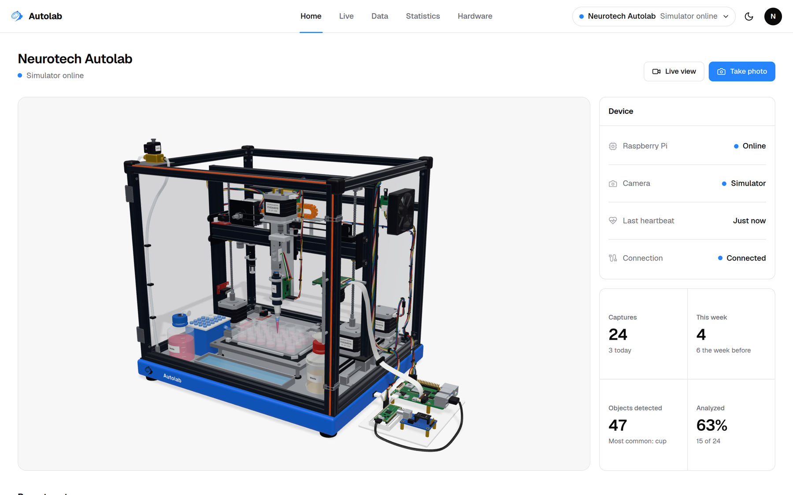
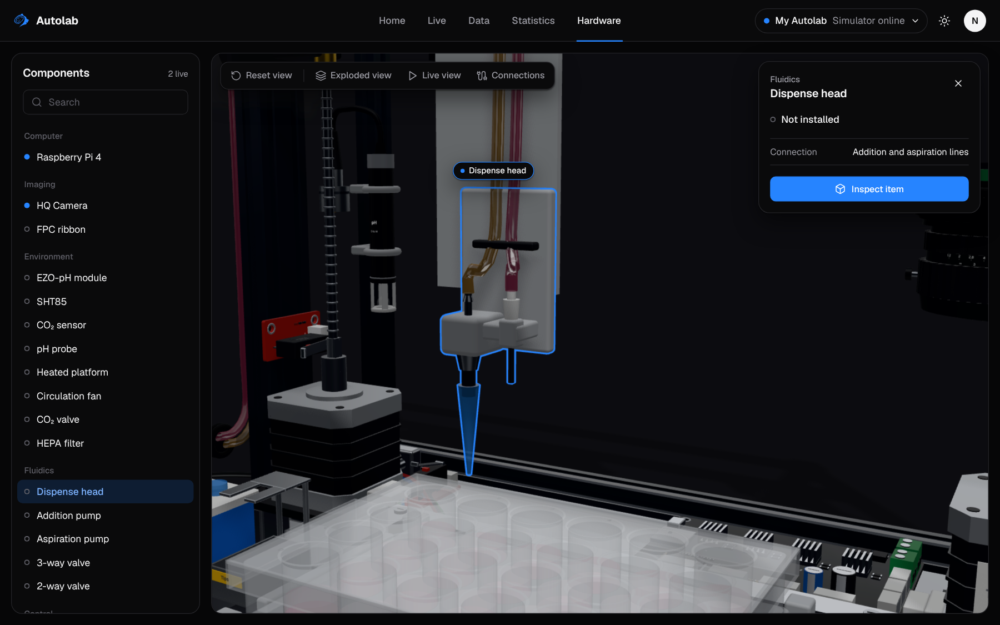
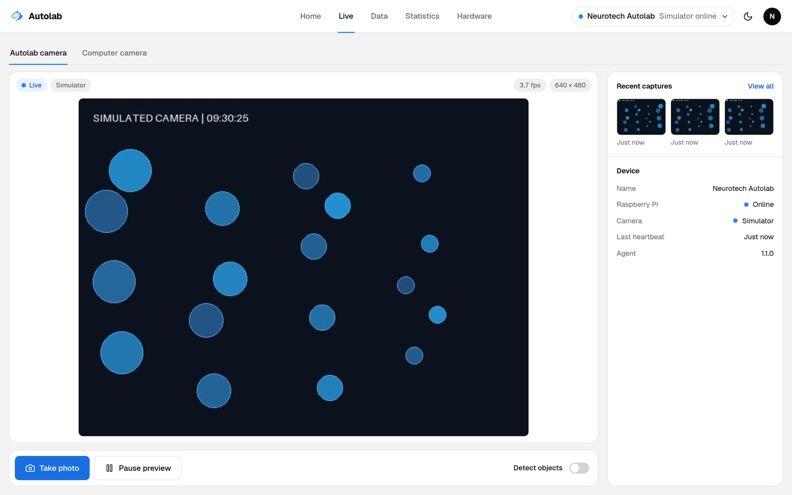
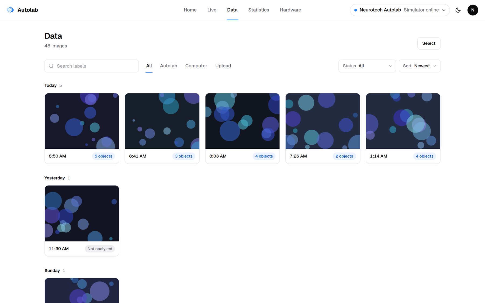
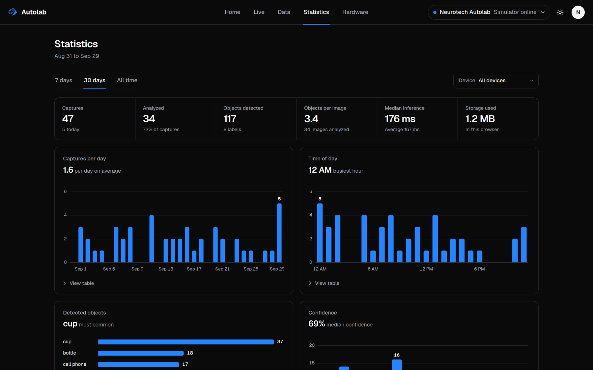
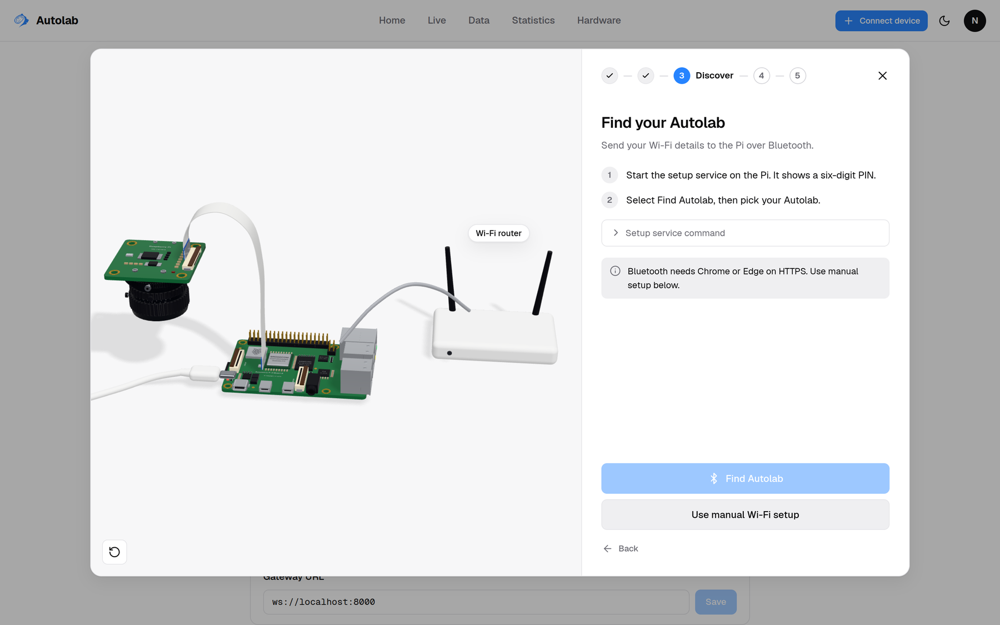

<p align="center">
  
</p>

<h1 align="center">Autolab</h1>

Autolab is a low cost automated cell culture system for neuronal cultures, built by the Neurotech wet lab team. A desktop 3D printer gantry sits inside an insulated enclosure that holds 37 °C, 5% CO₂ and 85 to 95% humidity. The gantry carries a motorized P1000 pipette for media changes and a Raspberry Pi HQ camera for checking the culture, all run by a Raspberry Pi 4.

This repository is the software. You sign in, connect your Autolab over Bluetooth, and then watch the live camera, take photos, run object detection and browse the results from anywhere. A 3D model of the whole machine shows every part and what state it's in.

## Screenshots





| Live camera | Image library |
| --- | --- |
|  |  |

| Statistics | Connect device |
| --- | --- |
|  |  |

The library and statistics shots use sample images, since object detection can't run where the screenshots were taken.

## What it does

- **Home** shows the whole machine in 3D, running a demo media change (picking up tips, drawing and dispensing media, ejecting tips), next to the device status, a few numbers and your latest photos.
- **Live** streams the Pi camera at about 4 frames a second, takes full resolution stills and can run object detection on the stream. It can also use your computer's camera or an uploaded photo.
- **Data** keeps every image with its detections. Filter, search by label, open an image, analyze it, download or delete.
- **Statistics** charts captures per day and by hour, detected objects, confidence, inference time and sources.
- **Hardware** is the 3D model. Click a part to fly to it, then **Inspect item** to see it on its own. **Exploded view** opens the enclosure and spreads the parts out. Parts without a driver yet say so instead of showing made up readings.
- **Connect device** walks through seating the camera ribbon and powering the Pi, then finds the Pi over Bluetooth and sends it your Wi-Fi details. Manual setup is there as a fallback.
- Light and dark mode, and it works on a phone.

## How it works

The Pi and the browser never talk to each other directly. Each one opens an outgoing WebSocket to a small Python gateway, which pairs them by device ID. That means the Pi needs no open ports and no port forwarding, and you can reach it from anywhere.

- The **Pi agent** (`devices/raspberry-pi`) runs Picamera2. It sends a heartbeat every 10 seconds, streams 640 by 480 JPEG frames only while someone is watching, and captures full resolution stills on request.
- The **gateway** (`services/gateway`, FastAPI) routes commands, frames and photos with bounded queues and timeouts. In cloud mode it also checks Supabase logins and device ownership, and it's the only place that holds the Supabase service key.
- The **web app** (`apps/web`, Next.js) does everything else. Object detection runs in the browser with ONNX Runtime Web and YOLOv10n, on WebGPU when available and WebAssembly otherwise, so no image leaves the browser for analysis. The 3D model is drawn with Three.js and React Three Fiber.

Photos travel as one binary WebSocket message each: a small JSON header followed by the raw JPEG, so a header can never get separated from its image.

There are two modes:

| | Demo (default) | Cloud |
| --- | --- | --- |
| Sign in | The fixed demo login `ntabuser` / `ntabuser123` | Supabase email and password |
| Connecting a Pi | Its Device ID | A one-time six-digit claim code |
| Where images live | This browser (IndexedDB) | Private Supabase Storage |

## Repository layout

| Path | What it is | Runs on |
| --- | --- | --- |
| `apps/web` | The web app. Routes in `app/`, everything else in `src/` by feature | Vercel or any Node host |
| `services/gateway` | The WebSocket and HTTP gateway | Any always-on host |
| `devices/raspberry-pi` | The camera agent and the Bluetooth setup service | Raspberry Pi 4 |
| `workers/ml` | Optional worker that saves analyses in cloud mode | Your computer |
| `supabase/migrations` | Tables, security rules and the storage bucket | Supabase |
| `tests` | Python tests and the browser end to end suite | CI |
| `docs` | Setup and design notes | |

## Getting started

You need Node.js 22 or newer and Python 3.11 or newer. Run each part in its own terminal, starting at the repository root.

**1. Web app**

```bash
npm ci
cp apps/web/.env.example apps/web/.env.local
npm run dev
```

Open http://localhost:3000 and sign in with `ntabuser` / `ntabuser123`.

**2. Gateway**

```bash
cd services/gateway
python3 -m venv .venv && source .venv/bin/activate
pip install -r requirements.txt
cp .env.example .env
uvicorn main:app --host 0.0.0.0 --port 8000 --workers 1
```

Or run `docker compose up --build gateway` from the root.

**3. A Pi, or the simulator**

To try it without hardware, run the agent in simulator mode on your computer:

```bash
cd devices/raspberry-pi
python3 -m venv .venv && source .venv/bin/activate
pip install -r requirements.txt
python -m autolab_agent.main --simulate --gateway ws://localhost:8000
```

It prints a Device ID. In the app, click **Connect device**, go through the steps, choose **Use manual Wi-Fi setup** and paste the ID. The simulator sends clearly labeled synthetic images.

### A real Raspberry Pi

1. Flash Raspberry Pi OS Lite (64-bit) with Raspberry Pi Imager and set the username, Wi-Fi, SSH and hostname there.
2. With the Pi powered off, connect the camera ribbon to the **CSI camera** connector (not the display connector), contacts facing the connector's contacts.
3. Boot, SSH in and check the camera:

```bash
sudo apt update
sudo apt install -y git python3-venv python3-pip python3-picamera2 python3-pil rpicam-apps
rpicam-hello --list-cameras
rpicam-still --nopreview -o test.jpg
```

4. Install and run the agent:

```bash
git clone https://github.com/edison16a/AutoLab.git
cd AutoLab/devices/raspberry-pi
python3 -m venv --system-site-packages .venv && source .venv/bin/activate
pip install -r requirements.txt
cp .env.example .env
python -m autolab_agent.main
```

Set `AUTOLAB_GATEWAY` in `.env` to your gateway's `wss://` address and replace `YOUR_USER` in `AUTOLAB_CREDENTIALS`. To start it on boot, fix the user and path in `systemd/autolab-agent.service`, then:

```bash
sudo cp systemd/autolab-agent.service /etc/systemd/system/
sudo systemctl daemon-reload
sudo systemctl enable --now autolab-agent
```

For Bluetooth setup from the app, see [Bluetooth setup](docs/bluetooth-provisioning.md). The Pi's identity file is created once with owner-only permissions; keep it when you update. Never put a Supabase key on the Pi.

### Cloud mode (Supabase)

[docs/cloud.md](docs/cloud.md) walks through creating the database, turning on sign in, which key goes where and every environment variable. In short:

| Where | Variables |
| --- | --- |
| Gateway | `AUTOLAB_MODE=cloud`, `SUPABASE_URL`, `SUPABASE_SERVICE_ROLE_KEY`, `ALLOWED_ORIGINS` |
| Web app | `NEXT_PUBLIC_AUTOLAB_MODE=cloud`, `NEXT_PUBLIC_GATEWAY_URL`, `NEXT_PUBLIC_SUPABASE_URL`, `NEXT_PUBLIC_SUPABASE_ANON_KEY` |
| Pi | `AUTOLAB_MODE=cloud`, `AUTOLAB_GATEWAY`, `AUTOLAB_CREDENTIALS` |

### Deploying

The web app goes on Vercel with the root directory set to `apps/web`. The gateway needs an always-on host with WebSockets, since Vercel can't run it. See [deployment](docs/deployment.md).

## Tests

```bash
npm ci && npm run build
python3 -m venv .venv
.venv/bin/pip install -r services/gateway/requirements.txt -r devices/raspberry-pi/requirements.txt
.venv/bin/pytest tests -q -k "not e2e"
npx playwright install chromium
.venv/bin/python tests/run_e2e.py
```

The end to end run starts the gateway, the production web app and the Pi simulator, then drives a real browser through sign in, connecting a device, the live camera, capture, detection on a real street photo, the library, the 3D hardware view, statistics, settings, phone layouts and the no-WebGL fallback. Ports 3000 and 8000 must be free. CI runs all of this on every push.

The real CSI camera, Bluetooth radio pairing and a live Supabase project still need a check on real hardware and accounts.

## More

- [Architecture and limits](docs/architecture.md)
- [Wire protocol](docs/protocol.md)
- [The 3D model](docs/digital-twin.md)
- [Browser object detection](docs/browser-detection.md)
- [Bluetooth setup](docs/bluetooth-provisioning.md)
- [Supabase setup](docs/cloud.md)
- [Deployment](docs/deployment.md)
